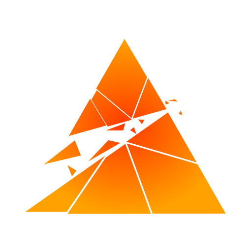

<h1>

&nbsp;Caden Moore
</h1>
A <strong>utilitarian</strong> programmer focused on <i>maximum</i> speed, <i>low</i> memory usage, and <i>efficiency</i> while retaining <i>ease-of-use</i> in software.

<h2>Current Projects</h2>

<table>
  <tr>
    <td width="100%">
<h2>

&nbsp;Terobit
</h2>
A multiplayer-first game engine based on <i>speed</i>, <i>low memory usage</i>, and <i>efficiency</i>, made in Rust. Based on the Bevy ECS and Rendering Engine. My primary and side project at this moment in time.
<h3>Features</h3>
<h4>Sandboxed Scripts</h4>
Scripts are run in a Wasmtime sandbox, over a contiguous, versioned API. Scripts only have access to what the host gives them access to, and nothing more. Running a WASM scripting stack allows for developers to use nearly any language compatible with WASM.
<h4>Efficient Backend</h4>
The backend runs off of the Bevy Engine. My main choice for this engine instead of running my own stack, was the features, ease-of-use, and support of the Bevy Community. I am not a graphics programmer, so I have a hard time with complex gpu buffer systems. Plus, maintaining a rendering engine, and an ECS engine, which are both very large projects, do not currently seem in scope for me.
<h4>Tiny Packing</h4>
Realm packages run compressed to save massive storage space in some projects. The use of ZSTD allows for efficient compressing while having insane unpacking speeds.
    </td>
  </tr>
  <td width="100%">

<h2>&nbspFIRST Robotics Team 9410</h2>
desc
    
  </td>
    
</table>
